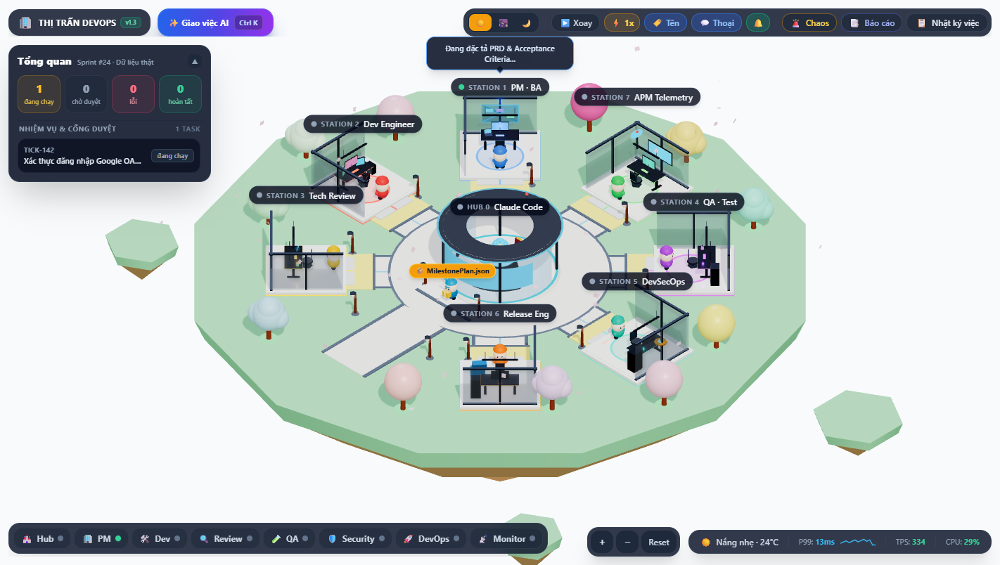
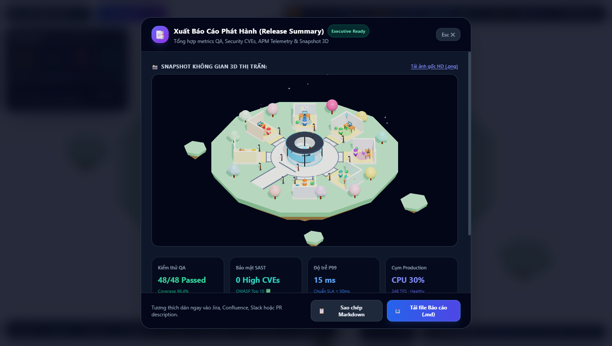
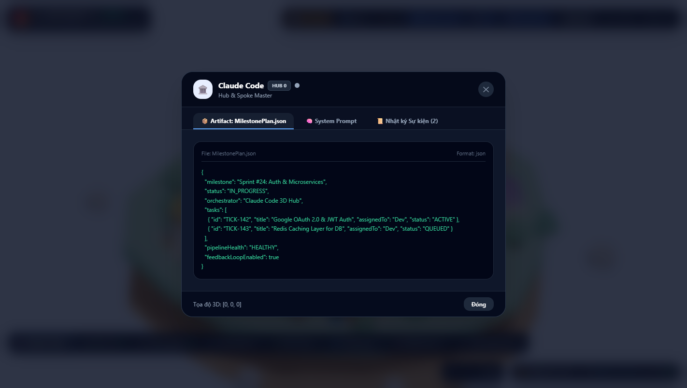

# 🏰 Thị trấn DevOps 3D (Agent Town 3D)

> **Mô phỏng Hệ thống 8 Autonomous AI Agents & DevOps SDLC Pipeline trên Hòn đảo bay 3D Isometric Diorama**  
> Xây dựng với **Next.js 16 (Turbopack)**, **React 19**, **Three.js / React Three Fiber v9**, **Google Gemini API**, **Zustand**, và **Web Audio API**.

[](https://nextjs.org/)
[](https://react.dev/)
[](https://docs.pmnd.rs/react-three-fiber)
[](https://ai.google.dev/)
[](https://github.com/pmndrs/zustand)
[](https://tailwindcss.com/)
[](https://www.typescriptlang.org/)
[](LICENSE)

---

<p align="center">
  
</p>

---

## 🌟 1. Tổng quan Dự án (Overview)

**Agent Town 3D** là nền tảng trực quan hóa sinh động quy trình phát triển và vận hành phần mềm hiện đại (SDLC). Toàn bộ chu trình từ tiếp nhận yêu cầu, viết specs PRD, lập trình mã nguồn, review code, kiểm thử tự động, quét bảo mật, đóng gói container cho đến giám sát APM telemetry đều được tự trị hóa bởi **8 Autonomous AI Agents** theo mô hình **Orchestrator Hub & Spoke**:

- 🏢 **Trung Tâm Chỉ Huy AI (AI Command Center / War Room - Claude Code)**: Tòa nhà điều hành kính trong suốt tại tâm hòn đảo, sở hữu Bàn Hologram 3D phát sáng và Dàn màn hình NOC giám sát, nhận prompt từ người dùng, phân rã milestone và điều phối luồng làm việc tới các trạm.
- 🏢 **7 Trạm Chuyên Môn Bố Cục Đối Xứng Hướng Tâm (Radial Polar Layout)**: Các phòng làm việc cắt lát (Cutaway Dollhouse) với đầy đủ nội thất, màn hình máy tính nhấp nháy, đèn lồng và radar xoay.
- 🏃 **Người Vận Chuyển 3D (Courier Shippers)**: Trực quan hóa việc truyền tải Artifacts (PR diff, Test report, Docker image) chạy trên hệ thống đường đá 7 nan hoa và vòng xuyến trung tâm.
- 🚴 **Vòng Lặp Phản Hồi Tự Động (Feedback Loop)**: Khi QA bắt lỗi hoặc Tech Review từ chối, Shipper đạp xe ngược về xưởng Dev để kỹ sư viết bản vá lỗi (hotfix patch).
- 🛡️ **Cổng Phê Duyệt Triển Khai (Production Approval Gate)**: Cơ chế Human-in-the-loop an toàn yêu cầu Tech Lead / Con người bấm duyệt trước khi triển khai lên Production.
- 🤖 **Hai Chế Độ Vận Hành Song Song**:
  1. **AI Thật (Real Gemini 2.5 API)**: Kết nối trực tiếp Google Gemini API để tạo artifacts thực thụ theo prompt tùy biến.
  2. **Giả lập Kịch bản (Mock Simulator)**: Mô phỏng tức thì các nhánh nghiệp vụ (tính năng mới, bắt bug token refresh, lỗi bảo mật SAST).

---

## 👥 2. Đặc tả 8 Autonomous AI Agents & Artifacts

| # | Trạm & Agent | Icon | Tòa nhà 3D | Tọa độ & Góc xoay | Vai trò & Trách nhiệm | Artifact Đầu Ra |
|---|---|:---:|---|:---:|---|---|
| **0** | **Claude Code** | 🏢 | Trung tâm chỉ huy kính (War Room) | `[0, 0.6, 0]`, $0^\circ$ | Orchestrator Hub: Phân tích prompt, phân rã milestone & điều phối pipeline | `MilestonePlan.json` |
| **1** | **PM · BA** | 🏢 | Văn phòng Tây Bắc | `[-6.5, 0.6, -6.5]`, $45^\circ$ | Đặc tả PRD, User Stories, tiêu chuẩn nghiệm thu Gherkin Given-When-Then | `PRD.md` |
| **2** | **Dev Engineer** | 🛠️ | Xưởng mộc Chính Tây | `[-9.2, 0.6, 0]`, $90^\circ$ | Viết mã nguồn Clean Architecture, xử lý validation & tạo Pull Request | `source-code.diff` |
| **3** | **Tech Review** | 🔍 | Cối xay gió Tây Nam | `[-6.5, 0.6, 6.5]`, $135^\circ$ | Principal Reviewer: Rà soát logic, boundary check, quyết định Approve/Reject | `ReviewComments.json` |
| **4** | **QA · Test** | 🧪 | Phòng lab Đông Bắc | `[6.5, 0.6, -6.5]`, $-45^\circ$ | Chạy tự động 48 test suites, kiểm thử biên & báo cáo tỷ lệ coverage | `TestReport.json` |
| **5** | **DevSecOps** | 🛡️ | Pháo đài Chính Đông | `[9.2, 0.6, 0]`, $-90^\circ$ | Quét SAST, kiểm tra CVE dependencies, phòng chống rò rỉ secret token | `SecurityScanReport.json` |
| **6** | **Release Eng** | 🚀 | Trạm bến tàu Đông Nam | `[6.5, 0.6, 6.5]`, $-135^\circ$ | Đóng gói Docker multi-stage, cấu hình CI/CD & điều phối Canary release | `Dockerfile` / `deploy.yaml` |
| **7** | **APM Monitor** | 📡 | Tháp canh radar Chính Bắc| `[0, 0.6, -9.2]`, $0^\circ$ | Watchdog SRE giám sát CPU, RAM, Latency P99 và TPS Production | `ClusterHealth.json` |

---

## 📐 3. Kiến Trúc Hình Học 3D & Mạng Lưới Giao Thông (Road Network)

Hệ thống ứng dụng mô hình **Kiến trúc Đối xứng Hướng tâm (Radial Polar Geometry)** để triệt tiêu 100% lỗi va chạm và đi xuyên tường:

```
                                [North: APM Monitor]
                                         │ (Avenue 7)
                                         ▼
                 [PM · BA] ───►  ╔═══════════════╗  ◄─── [QA · Test]
                (Avenue 1)       ║ Central Plaza ║       (Avenue 4)
                                 ║ Promenade Ring║
      [Dev Engineer] ─────────►  ║    (R = 4.4m) ║  ◄───────── [DevSecOps]
        (Avenue 2)               ║  Command Center ║             (Avenue 5)
                                 ╚═══════════════╝
               [Tech Review] ──►         │         ◄── [Release Eng]
                (Avenue 3)               │ (Avenue 6)   (Avenue 6)
                                         ▼
                                [South Royal Boulevard]
```

1. **Bán kính đồng nhất ($R = 9.2\text{m}$)**: Toàn bộ 7 trạm chuyên môn nằm trên cùng một đường tròn bán kính chuẩn, khoảng cách giữa các trạm liền kề đều tăm tắp ($\approx 4.7\text{m}$ khoảng trống thoáng đãng).
2. **Mặt trước mở 100% hướng về Lâu đài trung tâm**: Mọi căn phòng đều có góc quay $\text{rotY} = \text{atan2}(-x, -z)$. Mặt mở đối diện trực tiếp với lâu đài, còn vách tường sau quay ra biển ngoài rìa đảo.
3. **Mạng lưới 7 đại lộ nan hoa (7 Radial Avenues)**: Mỗi trạm sở hữu một đại lộ lát đá hoa cương trắng ngà (`0xf8fafc`) có gờ đá vỉa hè sẫm màu (`Curbs` `0x64748b`) nối thẳng tắp từ thềm cửa vào Vòng xuyến trung tâm.
4. **Centripetal Catmull-Rom Spline**: Thuật toán dẫn đường với tham số `centripetal` loại bỏ hoàn toàn hiện tượng vồng cong góc nhọn (overshoot), đảm bảo Shipper di chuyển 100% trên tim đường đá.

---

## 🎨 4. Điểm Nhấn Đồ Họa & Trải Nghiệm Người Dùng (Visual & UX)

- 🎮 **Điều Khiển Camera Tự Do Bằng Chuột (Interactive OrbitControls)**: Kéo chuột trái xoay 360° quanh đảo, chuột phải pan di chuyển góc nhìn mượt mà, con lăn chuột zoom vô cấp không giật; đồng bộ hai chiều với thanh trượt zoom của HUD.
- ⚡ **Dải Cáp Quang Dữ Liệu Phát Sáng (Glowing Neon Data Cables)**: 7 đường cáp ngầm phát quang neon chạy dọc theo 7 đại lộ nan hoa với các hạt xung photon (Data Stream Pulse) nhấp nháy theo trạng thái làm việc của từng trạm.
- 🔍 **Trình Xem Git Diff Chuẩn GitHub (Interactive Git Diff Viewer)**: Đánh số dòng, tô màu cú pháp trực quan (dòng thêm `+` xanh lá, dòng xóa `-` đỏ, chunk `@@` tím) và hỗ trợ chuyển đổi linh hoạt giữa `Unified View` và `Split View` 2 cột.
- 🚨 **Giả Lập Thử Tải Chịu Lỗi (Chaos Engineering & Load Surge 10x)**: Mô phỏng bão request đột biến khiến TPS tăng vọt 2,500, Latency vượt 168ms; APM Watchdog kích hoạt báo động đỏ và DevOps tự động kích hoạt HPA Auto-scaler (`ScaleUp.yaml`) để hạ nhiệt hệ thống về ngưỡng an toàn.
- 📑 **Xuất Báo Cáo Phát Hành Kèm Snapshot 3D (Executive Release Export)**: Tự động chụp lại ảnh snapshot 3D thị trấn từ WebGL Canvas, biên tập báo cáo phát hành tổng hợp số liệu kiểm thử QA, an ninh SAST, telemetry APM và hỗ trợ sao chép Markdown hoặc tải file `.md` / `.png`.
- 🏢 **7 Trạm Chuyên Môn Công Nghệ Cao (High-Tech Autonomous Labs)**: Thiết kế đồng bộ hoàn hảo với AI Command Center: Vách kính cường lực mờ khung nhôm graphite, sàn cleanroom trắng bóng tương phản, bàn nâng công thái học (Smart Standing Desk) viền LED neon phát sáng theo màu accent, đèn ray treo trần thông minh rọi sáng khi làm việc và trang bị đạo cụ độc bản (Triple monitor, Docker containers, Cyber vault, Server racks...).
- 🏢 **Trung Tâm Chỉ Huy AI (AI Command Center / War Room)**: Thay thế lâu đài cổ tích cũ bằng tòa nhà điều hành kính bán nguyệt trong suốt hiện đại, sở hữu **Bàn Hologram 3D lơ lửng phát sáng**, dàn màn hình NOC giám sát cong và ghế xoay thuyền trưởng.
- 🌸 **Tiểu Cảnh Hạt Môi Trường Sống Động (Particles Ambience)**:
  - `Ban ngày & Hoàng hôn`: 45 cánh hoa anh đào Sakura hồng pastel nhẹ nhàng bay lượn theo làn gió.
  - `Ban đêm`: 35 hạt đom đóm vàng ấm lung linh lượn sóng quanh các tán cây và đèn lồng cổ tích.
- ⚡ **Bộ Điều Tốc Pipeline (Speed Controller: 1x ➔ 2x ➔ 4x)**: Chuyển đổi tốc độ di chuyển của Shipper và nhún nhảy của Agent nhanh gấp đôi hoặc gấp 4 lần khi cần trình diễn/demo nhanh.
- 📇 **Hồ Sơ Kỹ Sư AI Chuyên Nghiệp (Agent Dossier Modal)**: Nhấp chuột vào bất kỳ trạm nào để xem Tech Stack chuyên môn (Playwright, Jest, Docker, ArgoCD...), System Prompt Core và nút **Sao chép mã** / **Tải file artifact**.
- 🎉 **Tương Tác 3D Nhảy Ăn Mừng (Jumping Cheer Animation)**: Khi click vào bất kỳ kỹ sư AI nào, nhân vật sẽ nhảy cẫng lên ăn mừng và giơ cao hai tay vẫy chào vui nhộn kèm âm thanh pop.
- 📊 **Telemetry APM Biến Thiên Thời Gian Thực**: Chỉ số CPU (%), P99 Latency (ms), TPS và Sparkline thay đổi trực tiếp theo tải trọng từng giai đoạn (QA test CPU 78%, Canary deploy CPU 59%, ổn định 24%).
- 🌅 **Chu kỳ Chiếu Sáng 3 Chế Độ (Day / Sunset / Night)**:
  - `Ban ngày (☀️)`: Ánh sáng mặt trời tươi sáng, rực rỡ, đổ bóng mềm PCF.
  - `Hoàng hôn (🌅)`: Bầu trời nhuộm cam hồng ấm áp, bóng nắng nghiêng dài nghệ thuật.
  - `Ban đêm (🌙)`: Bầu trời xanh tím huyền bí, **11 cây đèn lồng cổ tích (Fairy Lanterns)** tự động thắp sáng ánh vàng bập bùng lung linh dọc khắp các tuyến đường đá.
- 🔊 **Âm Thanh Tổng Hợp Web Audio API Thuần Client (`sfx.ts`)**:
  - Không tải bất kỳ file MP3 nặng nề nào; toàn bộ âm thanh được tổng hợp thời gian thực bằng Web Audio Oscillator và Noise Buffer:
  - ⌨️ Tiếng gõ phím lách cách khi Dev & PM làm việc.
  - 🔔 Tiếng chuông leng keng ấm áp (Delivery Chime) khi Shipper xuất phát.
  - 🚨 Tiếng còi cảnh báo bug alert khi QA phát hiện lỗi.
  - 🎺 Bản nhạc chiến thắng (Victory Fanfare) khi release Production thành công.
- 📊 **Bảng Widget "Tổng quan Milestone"**: Hiển thị 4 ô số liệu thống kê thời gian thực: `Đang chạy` | `Chờ duyệt` | `Lỗi` | `Hoàn tất`.
- 📋 **Hộp Thoại Nhật Ký Kích Thước Cố Định (Fixed-size Log Drawer)**: Cố định kích thước `420px × 380px` ở góc dưới bên phải, thanh cuộn nội bộ tự động, không bao giờ phình to làm vỡ giao diện.
- 💬 **Bong Bóng Thoại Lọc Thông Minh (Smart Speech Bubble De-clutter)**: Chỉ hiện lời thoại khi agent đang hoạt động tích cực hoặc khi được click chọn; triệt tiêu rối mắt.

### 📸 Bộ Sưu Tập Giao Diện (UI & 3D Showcase)

| 🏰 Toàn cảnh Thị trấn DevOps 3D Diorama | 📑 Xuất Báo Cáo Phát Hành (Executive Report) |
|:---:|:---:|
|  |  |

| 📇 Hồ Sơ Kỹ Sư AI & Tech Stack | 🔍 So Sánh Mã Nguồn Git Diff Trực Quan |
|:---:|:---:|
|  |  |

---

## 📂 5. Cấu Trúc Thư Mục (Project Structure)

```bash
agent-town-3d/
├── src/
│   ├── app/
│   │   ├── api/
│   │   │   └── pipeline/route.ts     # Endpoint Gemini 2.5 Flash / Flash Lite streaming
│   │   ├── globals.css               # Tailwind CSS & custom scrollbar styles
│   │   ├── layout.tsx                # Metadata & root HTML layout
│   │   └── page.tsx                  # Trang chính lắp ráp Canvas 3D & DOM HUD
│   ├── components/
│   │   ├── scene/
│   │   │   ├── TownScene.tsx         # R3F Canvas, ánh sáng Day/Night, Courier Ticker
│   │   │   ├── Island.tsx            # Đảo bay procedural low-poly với vách đất vát
│   │   │   ├── Castle.tsx            # Trung tâm chỉ huy kính (AI Command Center) & Bàn Hologram 3D
│   │   │   ├── Building.tsx          # 7 phòng làm việc cutaway dollhouse & vật dụng
│   │   │   ├── Character.tsx         # Agent chibi nhún nhảy, cheer jump & Shipper
│   │   │   ├── Path.tsx              # Vòng xuyến đại lộ, 7 đại lộ nan hoa, gờ đá curbs
│   │   │   ├── Lanterns.tsx          # Hệ thống 11 đèn lồng cổ tích vàng ấm
│   │   │   ├── Particles.tsx         # Cánh hoa anh đào Sakura & đom đóm đêm vàng ấm
│   │   │   ├── Tree.tsx              # Cây kẹo mút & cây đám mây bông pastel
│   │   │   ├── DataCables.tsx        # Cáp quang ngầm phát sáng & hạt photon dữ liệu
│   │   │   ├── Labels.tsx            # 3D Tracker chiếu nhãn và bong bóng thoại ra 2D DOM
│   │   │   └── CameraRig.tsx         # Điều khiển Camera Isometric & OrbitControls mượt mà
│   │   └── ui/
│   │       ├── Topbar.tsx            # Thanh điều khiển 1 dòng, theme, speed 1x/2x/4x, SFX
│   │       ├── MilestoneOverview.tsx # Bảng widget tổng quan 4 ô số liệu milestone
│   │       ├── LogDrawer.tsx         # Khung nhật ký cố định kích thước 420x380px
│   │       ├── RoleChips.tsx         # Thanh dock 8 trạm ở chân màn hình
│   │       ├── ApprovalModal.tsx     # Cổng duyệt Production Gatekeeper
│   │       ├── ArtifactModal.tsx     # Bộ thanh tra Artifacts đa tab & system prompt
│   │       ├── AgentDossierModal.tsx # Hồ sơ kỹ sư AI (Tech Stack, Prompt, Tải mã nguồn)
│   │       ├── GitDiffViewer.tsx     # Bộ so sánh mã nguồn Git Diff chuẩn GitHub (Unified / Split)
│   │       ├── ExportModal.tsx       # Modal xuất báo cáo phát hành kèm Snapshot 3D WebGL
│   │       ├── PromptModal.tsx       # Modal giao việc AI với 4 kịch bản tùy chọn
│   │       ├── ApiKeyModal.tsx       # Modal nhập Google Gemini API key bảo mật
│   │       └── StatusBar.tsx         # Thanh APM Telemetry (CPU, Latency, TPS) & Zoom
│   ├── lib/
│   │   ├── audio/
│   │   │   └── sfx.ts                # Bộ tạo âm thanh tổng hợp Web Audio API
│   │   ├── pipeline/
│   │   │   └── stages.ts             # Định nghĩa schemas, role types, stage order
│   │   └── scene/
│   │       ├── layout.ts             # Tọa độ Radial Polar chuẩn R=9.2m & màu sắc
│   │       └── waypoints.ts          # Centripetal Spline waypoints & interpolation
│   ├── store/
│   │   └── useTownStore.ts           # Central Zustand store quản lý state toàn app
│   └── styles/
│       └── tokens.ts                 # Design tokens & bảng màu hex diorama 3D
├── docs/
│   ├── images/                           # Bộ sưu tập ảnh chụp giao diện & 3D showcase
│   │   ├── town_diorama.png
│   │   ├── export_report_modal.png
│   │   └── agent_dossier_modal.png
│   └── archive/                          # Lưu trữ các kế hoạch nâng cấp & thiết kế lịch sử
├── AGENTS.md                             # Đặc tả chi tiết 8 AI Agents & Multi-Agent Architecture
├── CHANGELOG.md                          # Nhật ký thay đổi & lịch sử các phiên bản phát hành
├── POSTMORTEM_AND_LESSONS_LEARNED.md     # Nhật ký chi tiết các sự cố kỹ thuật & bài học khắc phục
├── README.md                             # Tài liệu tổng quan dự án & hướng dẫn khởi chạy
├── LICENSE                               # Giấy phép mã nguồn mở MIT
├── package.json                          # Next.js 16, R3F, Drei, Zustand, Tailwind dependencies
├── tailwind.config.ts                    # Cấu hình Tailwind CSS
└── tsconfig.json                         # TypeScript path mapping (@/*)
```

---

## 🚀 6. Hướng Dẫn Cài Đặt & Khởi Chạy (Quick Start)

### Yêu cầu tiên quyết:
- **Node.js**: v18.18 trở lên (Khuyến nghị Node.js v20+).
- **Trình duyệt**: Chrome, Edge, Firefox, Safari hỗ trợ WebGL 2.0 và Web Audio API.

### Bước 1: Cài đặt dependencies
```bash
npm install
```

### Bước 2: Chạy môi trường phát triển (Development)
```bash
npm run dev
```
Mở trình duyệt tại **`http://localhost:3000`** để khám phá thị trấn 3D.

### Bước 3: Cấu hình Google Gemini API Key (Tùy chọn)
Để chạy chế độ **Real AI Pipeline**:
1. Nhấp vào nút **`Giao việc AI (Ctrl+K)`** trên thanh Topbar hoặc mở modal API Key.
2. Dán mã API key từ [Google AI Studio](https://aistudio.google.com/). Mã khóa được lưu trữ an toàn trong `localStorage` trình duyệt.

### Bước 4: Build và chạy Production
```bash
npm run build
npm run start
```

---

## 📖 7. Tài Liệu Kỹ Thuật Tham Khảo

- 🤖 [**`AGENTS.md`**](file:///c:/Users/Admin/Documents/CV_Truong%20Dinh%20Anh/Ph%E1%BB%8Fng%20v%E1%BA%A5n/agent-town-3d/AGENTS.md): Đặc tả chi tiết System Prompt, hợp đồng dữ liệu đầu vào / đầu ra và cơ chế phối hợp giữa 8 AI Agents.
- 📜 [**`CHANGELOG.md`**](file:///c:/Users/Admin/Documents/CV_Truong%20Dinh%20Anh/Ph%E1%BB%8Fng%20v%E1%BA%A5n/agent-town-3d/CHANGELOG.md): Nhật ký lưu vết toàn bộ các phiên bản, tính năng mới và các đợt refactor kiến trúc từ v1.0 đến v1.2.
- 🛠️ [**`POSTMORTEM_AND_LESSONS_LEARNED.md`**](file:///c:/Users/Admin/Documents/CV_Truong%20Dinh%20Anh/Ph%E1%BB%8Fng%20v%E1%BA%A5n/agent-town-3d/POSTMORTEM_AND_LESSONS_LEARNED.md): Tài liệu lưu trữ 8 sự cố kỹ thuật tiêu biểu đã từng xuất hiện (lỗi đi xuyên tường, mặt đường mờ, lỗi layout, lỗi TypeScript...) kèm nguyên nhân gốc và biện pháp phòng ngừa vĩnh viễn.

---

## 📄 Giấy Phép (License)

Dự án được phân phối dưới giấy phép mã nguồn mở [MIT License](LICENSE).
