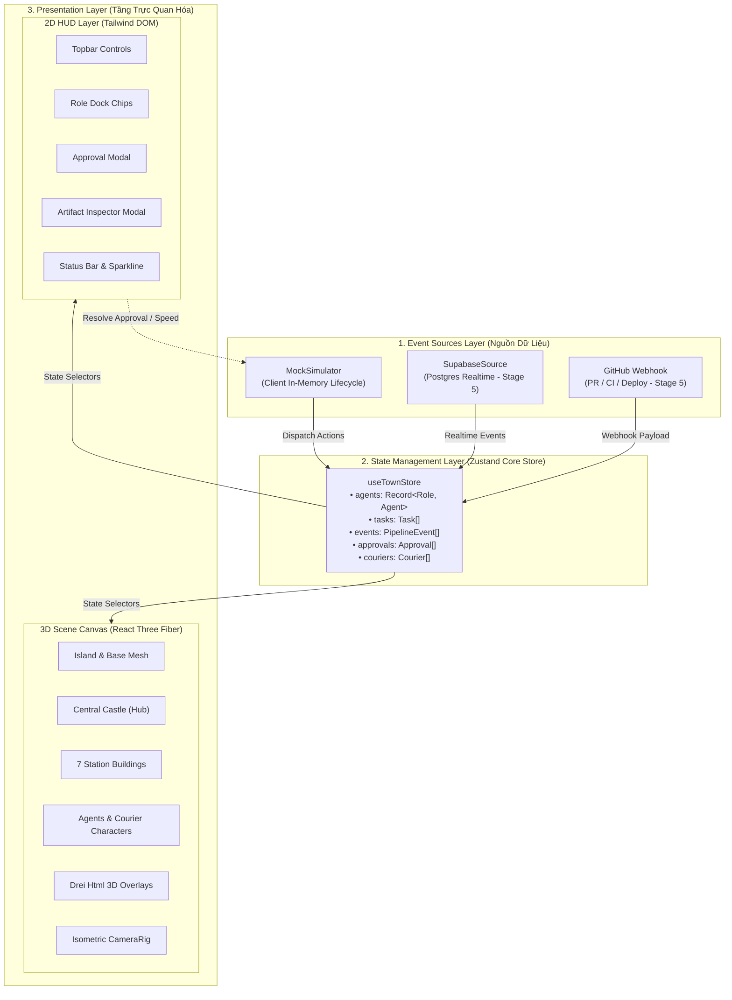
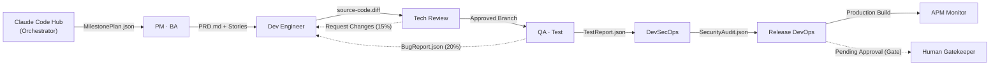
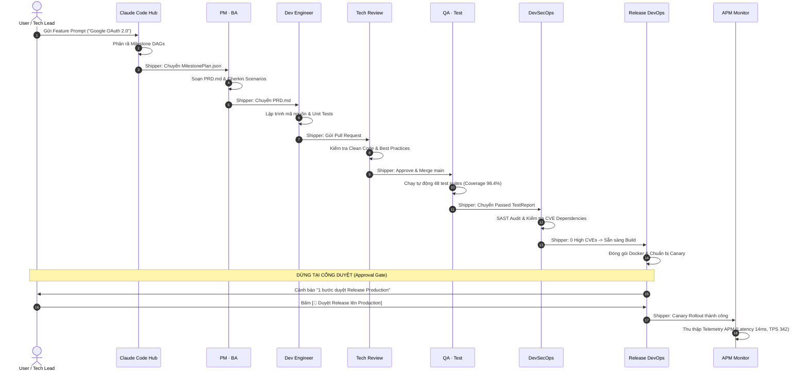
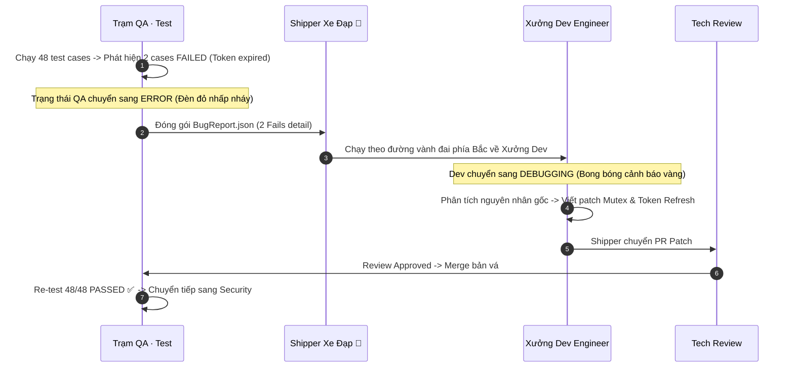
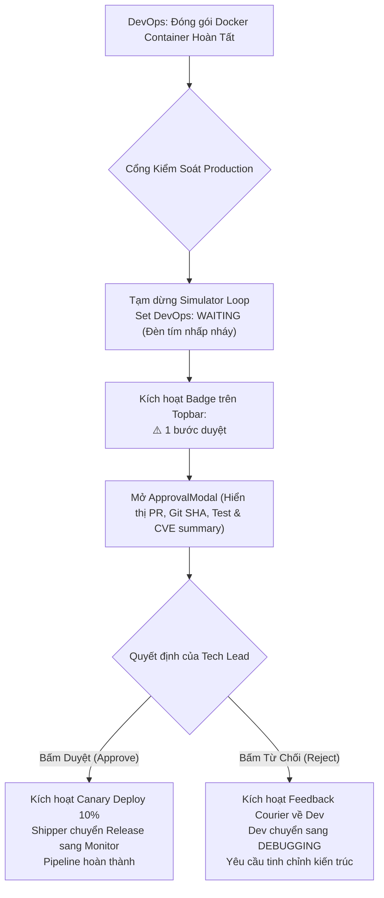
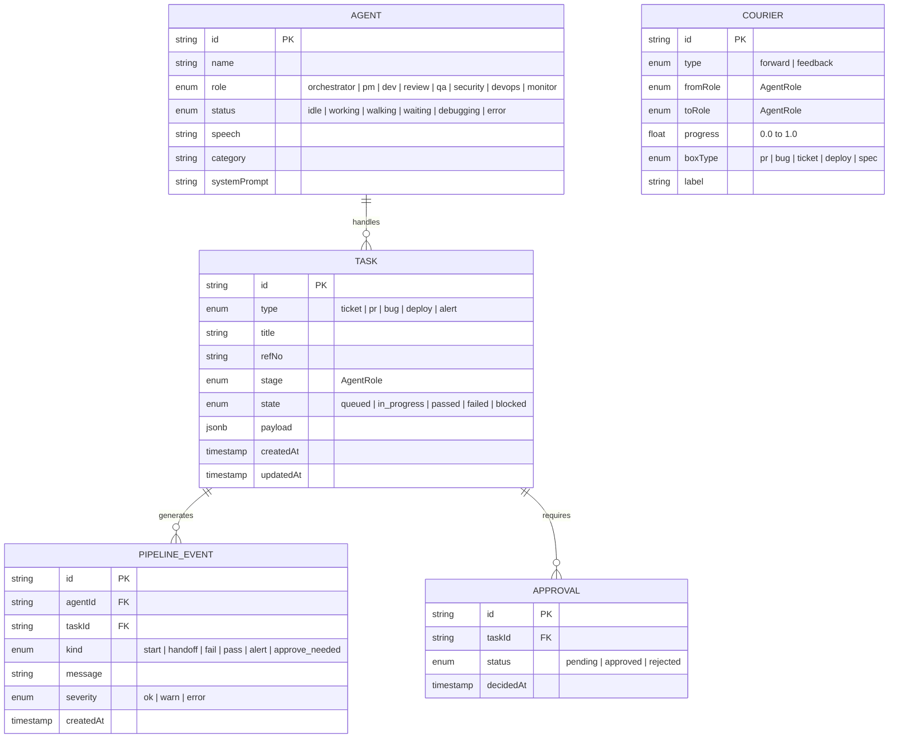

# 🏛️ TÀI LIỆU PHÂN TÍCH & THIẾT KẾ HỆ THỐNG (SYSTEM ANALYSIS & DESIGN)

> **Dự án:** Thị trấn DevOps 3D (Agent Town 3D)  
> **Phiên bản:** 1.0 (MVP)  
> **Kiến trúc cốt lõi:** Orchestrator Hub & Spoke Multi-Agent Architecture · Decoupled Event-Driven 3D Diorama  
> **Công nghệ:** Next.js 16 (Turbopack), React 19, React Three Fiber (R3F v9), Drei v10, Three.js, Zustand, TypeScript, Tailwind CSS

---

## 📌 1. TỔNG QUAN HỆ THỐNG (SYSTEM OVERVIEW)

### 1.1. Bối cảnh & Vấn đề giải quyết (Problem Statement)
Trong các hệ thống CI/CD truyền thống và các nền tảng Multi-Agent hiện nay:
- **Hiện trạng:** Tiến trình phát triển phần mềm (SDLC) được thể hiện dưới dạng văn bản tĩnh (terminal logs, GitHub actions logs, bảng Kanban hoặc chatbox đơn luồng).
- **Điểm yếu:** Khó theo dõi sự tương tác chéo giữa các agent chuyên môn, các vòng lặp phản hồi (feedback loops) khi test thất bại hoặc review bị từ chối thường bị che khuất trong hàng nghìn dòng log, thiếu tính trực quan và giảm khả năng giám sát của con người (*Human-in-the-Loop*).
- **Giải pháp của Agent Town 3D:** Trực quan hóa toàn bộ vòng đời SDLC thành một **hòn đảo 3D isometric tương tác thời gian thực**:
  - 8 Tác nhân AI tự trị phân chia nhiệm vụ theo cấu trúc Hub & Spoke.
  - Dữ liệu, code patch, test report được vật lý hóa thành các thùng hàng (cargo boxes) do **Shipper Couriers 3D** vận chuyển qua hệ thống đường đá.
  - Vòng lặp phản hồi (Feedback loop) kích hoạt shipper xe đạp quay ngược về trạm Dev mang theo báo cáo lỗi.
  - Tích hợp cổng phê duyệt con người (*Production Approval Gate*) ngăn chặn việc phát hành tự động không kiểm soát.

### 1.2. Mục tiêu thiết kế kiến trúc (Architectural Goals)
1. **Decoupled Architecture:** Tách bạch 100% giữa Tầng Mô phỏng / Nguồn sự kiện (*Event Source*), Tầng Quản lý Trạng thái (*Zustand Store*) và Tầng Hiển thị (*3D Canvas & 2D DOM*). Thay đổi nguồn dữ liệu từ Mock sang GitHub Webhook không làm thay đổi bất kỳ dòng code UI nào.
2. **Deterministic State & Data Contracts:** Mọi sự chuyển giao giữa các agent phải tuân thủ hợp đồng dữ liệu nghiêm ngặt dạng Artifacts (`PRD.md`, `source-code.diff`, `TestReport.json`, v.v.).
3. **High-Performance 3D Visualization:** Duy trì 60 FPS ổn định trên trình duyệt tiêu chuẩn thông qua kỹ thuật tạo hình thủ tục (procedural low-poly modeling) và tối ưu hóa chu kỳ render.

---

## 🏗️ 2. KIẾN TRÚC TỔNG THỂ (HIGH-LEVEL ARCHITECTURE)

Hệ thống ứng dụng mô hình **Decoupled Event-Driven Pipeline** gồm 3 tầng độc lập:

### Các nguyên tắc phân tầng:
1. **Tầng Nguồn Dữ Liệu (Event Sources Layer):** Triển khai interface chung `IEventSource` ([`src/lib/events/EventSource.ts`](file:///c:/Users/Admin/Documents/CV_Truong%20Dinh%20Anh/Ph%E1%BB%8Fng%20v%E1%BA%A5n/agent-town-3d/src/lib/events/EventSource.ts)). `MockSimulator` chịu trách nhiệm kích hoạt các kịch bản phần mềm, tính toán tỷ lệ xác suất lỗi và điều phối bước tiến pipeline.
2. **Tầng Trạng Thái (Zustand Store):** Đóng vai trò là *Single Source of Truth* ([`src/store/useTownStore.ts`](file:///c:/Users/Admin/Documents/CV_Truong%20Dinh%20Anh/Ph%E1%BB%8Fng%20v%E1%BA%A5n/agent-town-3d/src/store/useTownStore.ts)). Mọi trạng thái hiển thị (tọa độ courier, trạng thái đèn tín hiệu, danh sách task, modal) đều được lưu trữ tại đây.
3. **Tầng Hiển Thị (Presentation Layer):**
   - **WebGL 3D:** Sử dụng `@react-three/fiber` để dựng đồ họa, đổ bóng và nội suy chuyển động.
   - **DOM 2D:** Sử dụng Tailwind CSS hiển thị thanh công cụ điều khiển, dock thông số và modal tương tác với độ trễ thấp.

---

## 👥 3. ĐẶC TẢ HỢP ĐỒNG DỮ LIỆU & ARTIFACTS (DATA CONTRACTS)

Mỗi agent là một micro-service độc lập nhận input và sản xuất output artifact rõ ràng:

### Bảng hợp đồng dữ liệu chi tiết giữa 8 Agent:

| Trạm | Tên Agent | Input Artifact | Output Artifact | Format | Mô tả trách nhiệm |
|---|---|---|---|:---:|---|
| **0** | **Claude Code** | User Feature Prompt | `MilestonePlan.json` | JSON | Phân tích yêu cầu, phân rã milestone và điều phối luồng thực thi |
| **1** | **PM · BA** | `MilestonePlan.json` | `PRD.md` | Markdown | Lập đặc tả chức năng, User Stories và tiêu chí nghiệm thu Gherkin |
| **2** | **Dev Engineer** | `PRD.md` hoặc `BugReport.json` | `source-code.diff` | Git Diff | Triển khai Clean Code, xử lý boundary checks và tạo Pull Request |
| **3** | **Tech Review** | `source-code.diff` | `ReviewComments.json` | JSON | Rà soát AST code smells, memory leak và ra quyết định Merge / Reject |
| **4** | **QA · Test** | Merged Main Branch | `TestReport.json` | JSON | Chạy 48 test suites tự động, xuất tỷ lệ pass/fail & coverage |
| **5** | **DevSecOps** | Source Code & Deps | `SecurityScanReport.json` | JSON | Quét SAST, kiểm tra CVE package (Trivy), rà soát rò rỉ API secrets |
| **6** | **Release DevOps**| Passed Audit Artifacts | `Dockerfile`, `deploy.yaml` | Container | Build container multi-stage, kích hoạt Blue-Green / Canary deploy |
| **7** | **APM Monitor** | Production Telemetry | `ClusterHealth.json` | JSON | Đo đạc P99 Latency, TPS, CPU, Error Rate qua Prometheus APM |

---

## 🔄 4. MÔ HÌNH LUỒNG HOẠT ĐỘNG (SEQUENCE DIAGRAMS)

### 4.1. Luồng Thuận (Happy Path End-to-End)

---

### 4.2. Luồng Vòng Lặp Phản Hồi (Feedback Loop: QA Thất Bại)

Khi bộ kiểm thử QA phát hiện lỗi (xác suất ~20% cấu hình tại [`PIPELINE_PROBABILITIES`](file:///c:/Users/Admin/Documents/CV_Truong%20Dinh%20Anh/Ph%E1%BB%8Fng%20v%E1%BA%A5n/agent-town-3d/src/lib/pipeline/stages.ts)):

---

### 4.3. Cổng Phê Duyệt Triển Khai (Human-in-the-Loop Approval Gate)

Cơ chế phòng thủ chiều sâu (Defense-in-Depth) đảm bảo AI không tự ý can thiệp vào môi trường Live Production:

---

## 🗄️ 5. MÔ HÌNH DỮ LIỆU ENTITY-RELATIONSHIP (DATA SCHEMA)

Toàn bộ hệ thống quản lý dữ liệu theo mô hình quan hệ phi tập trung (Decentralized Entity Model):

---

## 🕹️ 6. THIẾT KẾ ĐỒ HỌA 3D & HỆ THỐNG ĐƯỜNG DẪN (3D SCENE & NAVIGATION)

### 6.1. Chiếu trực giao Isometric (Orthographic Camera Design)
* **Thông số Camera:** Tọa độ đặt `[25, 26, 25]`, góc nhìn `[0, 0, 0]`, chuẩn Isometric $45^\circ$, `zoom = 32`.
* **Ưu điểm so với Perspective Camera:**
  - Không bị biến dạng tỷ lệ khi vật thể ở xa (Parallel Projection), giúp toàn bộ các công trình trên đảo giữ được bố cục đồng đều chuẩn phong cách mô hình đồ chơi (*Diorama Mini-world*).
  - Độ sâu và kích thước vật thể không phụ thuộc khoảng cách camera $\to$ dễ dàng căn chỉnh tọa độ nhãn HUD 2D.

### 6.2. Hệ thống định tuyến nội suy Catmull-Rom (Spline Waypoints)
Để nhân vật Shipper di chuyển tự nhiên trên đường đá mà không đi xuyên qua lâu đài trung tâm:
1. Xác định điểm đầu $P_{start}$ (trạm gửi) và điểm đích $P_{end}$ (trạm nhận).
2. Tính toán điểm trung gian $P_{mid} = \frac{P_{start} + P_{end}}{2}$.
3. Nếu $\|(P_{mid.x}, P_{mid.z})\| < R_{castle}$ ($4.5$m), đẩy vector $P_{mid}$ hướng ra ngoài vành đai tròn:
   $$\theta = \text{atan2}(P_{mid.z}, P_{mid.x}), \quad P_{mid.x} = R_{ring} \cdot \cos\theta, \quad P_{mid.z} = R_{ring} \cdot \sin\theta$$
4. Tạo đường cong nội suy 3D: `new THREE.CatmullRomCurve3(waypoints, false, 'catmullrom', 0.2)`.
5. Tính góc xoay hướng mặt của shipper theo đạo hàm tiếp tuyến đường đi:
   $$\text{rotationY} = \text{atan2}(\Delta x, \Delta z)$$

### 6.3. Tối ưu hóa Drei `<Html>` trong Orthographic Projection
* **Vấn đề đã khắc phục:** Thuộc tính `distanceFactor` của `@react-three/drei` vốn được thiết kế cho Perspective Camera (chia tỷ lệ theo khoảng cách phối cảnh $1/d$). Khi áp dụng vào Orthographic Camera, Drei tự động nhân tỷ lệ lên $576 \times$ làm vỡ giao diện.
* **Giải pháp:** Loại bỏ `distanceFactor` trong camera trực giao; sử dụng kích thước DOM chuẩn CSS Tailwind (`max-w-[210px]`, `px-2.5 py-1`) bám theo tọa độ ma trận 3D của đỉnh tháp tòa nhà.

---

## 🛡️ 7. YÊU CẦU PHI CHỨC NĂNG (NON-FUNCTIONAL REQUIREMENTS - NFR)

| Tiêu chuẩn | Chỉ số mục tiêu | Thiết kế đáp ứng thực tế |
|---|:---:|---|
| **Hiệu năng khung hình (FPS)** | $\ge 60$ FPS | Toàn bộ hình học đảo, lâu đài và 7 trạm đều là **Procedural Mesh** (Box, Cone, Cylinder, Extrude) với số lượng polygon thấp (*Low-Poly*), không phụ thuộc vào việc tải file texture nặng. |
| **Độ trễ phản hồi UI (Latency)** | $\le 16$ms | State được quản lý qua Zustand Selectors (chỉ re-render component đăng ký biến thay đổi, tránh re-render toàn bộ 3D Canvas). |
| **Kích thước gói ứng dụng (Bundle Size)** | First Load $\le 105$ kB | Dynamic import `TownScene` với `ssr: false`, tách nhỏ vendor chunk `three` và `react-three-fiber`. |
| **An toàn hệ thống (Security)** | Zero-Trust Gate | Mọi lệnh deploy lên môi trường Production bắt buộc phải đi qua State Gate (`Approval.status === 'approved'`), không cho phép Agent tự động bypass. |
| **Tính mở rộng (Extensibility)** | Plug-and-Play | Thiết kế interface `IEventSource` cho phép cắm thẳng kết nối Supabase Realtime / GitHub Webhook mà không cần chỉnh sửa bất kỳ component hiển thị nào. |

---

## ⚖️ 8. PHÂN TÍCH ĐÁNH ĐỔI KIẾN TRÚC (ARCHITECTURAL TRADE-OFFS)

| Hạng mục quyết định | Phương án lựa chọn | Phương án thay thế | Lý do & Đánh đổi (Trade-off) |
|---|---|---|---|
| **3D Engine Framework** | **React Three Fiber (R3F)** | Vanilla Three.js | **Lựa chọn R3F:** Giúp quản lý cấu trúc Scene theo dạng cây Component phản ứng (Declarative UI), dễ dàng đồng bộ với Zustand state. Đánh đổi: Cần kiểm soát chặt chẽ re-render hooks để giữ 60 FPS. |
| **Mô hình 3D Assets** | **Procedural Geometry** | File 3D `.glb` / `.gltf` tải ngoài | **Lựa chọn Procedural:** Khởi chạy tức thì không tốn thời gian tải assets 3D qua mạng, không lỗi thiếu texture, màu sắc đồng bộ chuẩn bảng màu Tailwind. Đánh đổi: Độ chi tiết mô hình giới hạn ở mức low-poly cách điệu. |
| **Kiến trúc State** | **Zustand** | Redux Toolkit / Context API | **Lựa chọn Zustand:** Cực nhẹ (~1kB), không cần Context Provider bao bọc ngoài Canvas, cho phép component ngoài DOM và bên trong WebGL cùng truy cập một store duy nhất mà không gây re-render chéo. |
| **Cổng Duyệt Sản Phẩm** | **Human-in-the-Loop Gate** | 100% Fully Autonomous | **Lựa chọn Human Gate:** Đảm bảo tính an toàn trong kỹ thuật phần mềm doanh nghiệp, giảm thiểu rủi ro ảo giác (*hallucination*) từ AI tác động vào cụm Production. |

---

## 🚀 9. KẾ HOẠCH PHÁT TRIỂN TIẾP THEO (ROADMAP)

* [x] **Giai đoạn 0–4 (Hoàn thành):** Dựng cảnh 3D diorama isometric, 8 AI agents, hệ thống shipper couriers, vòng lặp phản hồi feedback loop, cổng duyệt Production và bộ thanh tra Artifacts Inspector.
* [ ] **Giai đoạn 5 (Dữ liệu thật):** Tạo bảng Supabase Postgres Realtime và route API `/api/webhook/github` nhận chữ ký HMAC từ repository GitHub thực tế.
* [ ] **Giai đoạn 6 (Agent LLM thật):** Kết nối Gemini API / Claude API vào trạm Tech Review và QA để phân tích git diff thật và tự động sinh test cases.
* [ ] **Giai đoạn 7 (Đóng gói Cloud):** Deploy Vercel Production và tích hợp CDN caching.

---
*Tài liệu được khởi tạo và kiểm chứng kỹ thuật cùng mã nguồn thực tế tại dự án `agent-town-3d`.*
